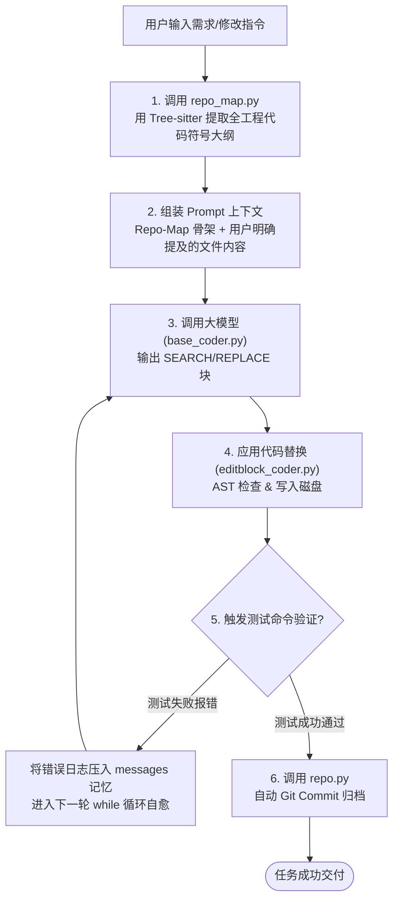

# Aider 核心源码架构与精读指南 (Auto-Dev Agent 必学必抄秘籍)

Aider 是目前开源界代码生成与工程维护水准最高的 AI Pair Programming 工具。  
阅读 Aider 的核心目标不是学习其 CLI 界面，而是学习它的 **四大底层硬核机制**：
1. **Repo-Map 全仓符号拓扑感知**（如何不爆 Token 让大模型俯瞰上万行工程代码）
2. **多模式编辑协议（Edit Formats）**（大模型如何稳定、精确地修改代码，避免幻觉输出全量文件）
3. **Coder 核心调度循环（原生 while 状态机）**（不用任何重型框架，如何把对话、工具、Git 补丁驱动起来）
4. **Git 自动化原子提交（Auto-Commit & Auto-Undo）**（测试未跑通自动撤销、跑通自动生成提交信息）

---

## 一、必须精读的核心源码文件清单（按优先级排序）

在克隆或浏览 Aider 源码 (`https://github.com/Aider-AI/aider`) 时，请严格按照以下顺序精读：

### 1. ⭐⭐⭐⭐⭐ 全球首创的工程符号感知图：`aider/repo_map.py`
- **对应业务价值**：Auto-Dev Agent 最关键的技术瓶颈是“模型不知道项目全局有哪些函数和类”。
- **精读关注点**：
  - 关注它如何使用 `tree-sitter` 提取 Python/JS/Go 等各语言的 AST 语法树。
  - 关注它如何抓取：类名（`ClassDef`）、函数签名（`FunctionDef`）、全局变量及导出符号。
  - **核心算法**：关注其中的 **PageRank / 图排序算法**。当代码库太大时，它如何计算哪些类和函数是“最关键的核心节点”，并把它们压缩进 1024~4096 Token 的骨架描述中喂给模型。

### 2. ⭐⭐⭐⭐⭐ 大模型稳定改代码的底座：`aider/coders/base_coder.py`
- **对应业务价值**：理解不用 LangGraph 时，纯原生 Python 是如何实现 Agent 核心主循环的。
- **精读关注点**：
  - 方法 `run()` / `run_loop()`：观察它经典的 `while` 循环状态机设计。
  - 观察它是如何维护 `self.cur_messages` 与上下文历史的。
  - 观察它在循环中如何处理反射反思（Reflection）：当单测报错或语法报错时，如何把错误文本追加进下一轮继续让大模型修正。

### 3. ⭐⭐⭐⭐ 各种代码编辑协议实现：`aider/coders/editblock_coder.py` 与 `aider/coders/wholefile_coder.py`
- **对应业务价值**：大模型改代码时，是输出整个文件、输出统一 Diff（`--- a/ +++ b/`），还是输出类似 SEARCH/REPLACE 块？
- **精读关注点**：
  - Aider 经过数百次 Benchmark 发现：大模型直接输出 `git diff` 极易算错行号导致 `patch failed`；输出全量文件又太慢且容易截断。
  - **重点看 `editblock_coder.py`**：Aider 首创的 **`<<<<<<< SEARCH ... ======= ... >>>>>>> REPLACE`** 模式是如何解析并精准替换原代码的。

### 4. ⭐⭐⭐⭐ Git 自动化管理与版本闭环：`aider/repo.py`
- **对应业务价值**：Auto-Dev Agent 每完成一个任务，都需要与 Git 分支和 Commit 深度集成。
- **精读关注点**：
  - 观察 Aider 如何利用 `GitPython` 自动监控文件的 `dirty` 未提交状态。
  - 观察代码改动成功并通过后，它如何自动调用模型生成标准的 Conventional Commit 信息（例如 `feat: ...`, `fix: ...`）。
  - 观察测试跑崩时，它如何调用 `git reset` 自动执行**优雅回滚（Rollback）**。

### 5. ⭐⭐⭐ 提示词工程的典范：`aider/coders/editblock_prompts.py`
- **对应业务价值**：看工业级顶尖 Agent 的 System Prompt 是怎么写的。
- **精读关注点**：
  - 看它是如何“恐吓”或严厉约束模型“绝对不要为了偷懒写 `# ... rest of code unchanged ...`”。
  - 看它是如何引导大模型保持原代码的缩进和注释风格。

---

## 二、可以完全跳过（先不用看）的代码

为了不浪费时间和精力，以下目录先 **不要看**：
- `aider/gui.py`、`aider/browser.py`（网页和前端交互，不属于核心 Agent 逻辑）
- `aider/args.py`（命令行参数解析）
- `aider/voice.py`（语音输入功能）
- `aider/watch.py`（文件监视器）

---

## 三、Aider 的单次任务执行核心流转图

---

## 四、阅读时的关键思考题（边看边对比我们之前的 SWE 项目）

1. **Repo-Map 怎么移到我们的项目里？**
   - 我们的 SWE 项目用正则和 AST 解析单个文件；Aider 的 `repo_map.py` 能够扫描整个项目工程，这个模块完全可以独立扣出来，作为一个标准工具给 Agent 使用。
2. **代码修改协议（Editblock vs Diff）**：
   - 我们的 SWE 项目用的是简单的统一补丁 Diff；Aider 为什么坚持用 `SEARCH/REPLACE` 块？哪种更容易让国产模型（如 Qwen/DeepSeek）写对？
3. **从单文件到多文件的跳跃**：
   - Aider 是怎么在一个对话里同时修改 2~3 个相互依赖的文件的？
