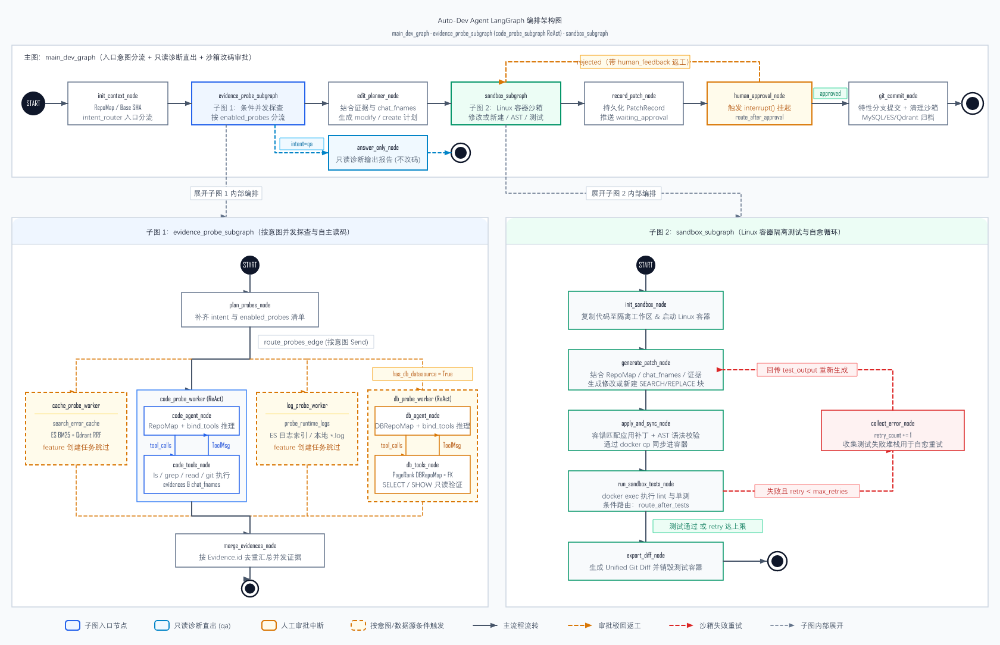

# Auto-Dev Agent

> **基于 LangGraph 的企业级自主研发、代码排障与错误自愈代理系统**
>
> 融合 **Aider** 的仓库大纲（RepoMap）、文件精准编辑与前缀缓存机制，以及 **my_swe** 的分层设计、多源证据收集脱敏与双路经验检索体系。

---

## 架构全景

系统采用 **1 个主编排图 + 2 个核心子图** 的双层隔离架构，兼顾多源探查的自主性与代码执行的环境隔离安全。



---

## 核心特性

### 1. 入口意图三路分流与精准探针派发 (`intent_router`)
- 自动根据用户需求意图分流为：**故障修复 (`bugfix`)**、**功能研发 (`feature`)** 与 **只读诊断问答 (`qa`)**。
- **只读诊断短路收束**：`qa` 任务在证据收集完毕后直接走 `answer_only_node` 输出诊断报告，绝不误入代码修改和沙箱执行。
- **按需启用探针**：`feature` 创建跳过报错日志；`bugfix` 启用全量探查；未挂载数据库数据源时不触发库表探测。

### 2. 双子图状态与环境隔离
- **证据探查子图 (`evidence_probe_subgraph`)**：
  - **自主源码探查 (`code_probe_subgraph`)**：2 节点 ReAct 循环架构（`code_agent_node` $\leftrightarrow$ `code_tools_node`），模型自主调用 `read_repo_file`、`search_repo_code`、`list_repo_directory`、`git_recent_commits` 探索调用链，动态将关键文件维护进 `chat_fnames`。
  - **自主数据库探查 (`db_probe_subgraph`)**：2 节点 ReAct 循环架构，结合 `DBRepoMap` 自动探测表结构、主键与外键关联拓扑（PageRank 排序），并可自主发起只读 `SELECT / SHOW / EXPLAIN` 核验证据。
  - **报错经验检索 (`cache_probe_worker`)**：`Elasticsearch (BM25)` + `Qdrant (向量)` 双路召回历史 Runbook，通过 `RRF (k=60)` 倒数秩融合。
  - **运行日志探针 (`log_error`)**：优先直读 ES 业务日志索引；未配置时无缝降级扫描本地日志文件。
  - **统一证据签发与脱敏**：所有工具输出统一经 `evidence_collector` 敏感词脱敏、截断并签发不可伪造的证据对象（`Evidence`）。
- **Linux 容器沙箱子图 (`sandbox_subgraph`)**：
  - 代码在独立 Docker 容器内运行，彻底杜绝恶意代码对宿主机系统的破坏与环境污染。
  - 采用 **Aider 风格的 `SEARCH/REPLACE` 代码块精准修改**（新建文件为空 `SEARCH` 块），经 AST 语法校验，避免模型计算统一 Diff 行号偏移导致代码混乱。
  - 具备**测试失败自愈循环（Self-Correction）**：测试未通过时捕获报错日志回传模型自动调整补丁，直至测试通过或达最大重试上限。

### 3. Prompt Cache 稳定前缀分层架构 (`ChatChunks`)
针对大模型服务端（OpenAI / Anthropic Claude / DeepSeek）的 KV Cache 机制，按**变动频率由低到高（最静态 $\rightarrow$ 最动态）**组装上下文：
$$\text{System Prompt} \rightarrow \text{[REPO\_MAP]} \rightarrow \text{[DB\_REPO\_MAP]} \rightarrow \text{[CHAT\_FILES]} \rightarrow \text{[EVIDENCE\_POOL]} \rightarrow \text{History} \rightarrow \text{User Query}$$
确保多轮对话和沙箱重试过程中，前缀 Token 序列高度一致，大幅提升云端 Prompt Cache 命中率并降低计费与延迟。

### 4. 强类型结构化规划 (`EditPlanOutput`)
在进入修改阶段前，强制模型输出符合 Pydantic 规范的结构化规划：
- 显式声明整体思路 `thought`、修改目标文件清单 `target_files` 及具体操作步骤 `plan`。
- 自动将目标文件合并注入 `chat_fnames`，由 `load_chat_files_block` 提取完整源码注入正文上下文。

### 5. 人工确认中断机制 (`human_approval_node`)
沙箱测试通过生成补丁后，主图进入 LangGraph `interrupt` 断点挂起等待人工审批：
- **批准 (`approved`)**：分支自动创建 Git Commit，同时将本次报错特征与修复 Runbook 三端同步沉淀至 MySQL + ES + Qdrant 知识库。
- **驳回 (`rejected`)**：支持用户携带修改意见，回退至沙箱子图由模型根据批注重新生成补丁。

---

## 技术栈

| 分层 / 领域 | 核心组件 | 说明 |
|---|---|---|
| **语言与运行时** | Python 3.12+ | 强类型注解、协程异步体系 (`asyncio` / `anyio`) |
| **Agent 与编排框架** | LangGraph 1.2+ / LangChain Core | 状态机驱动、子图隔离、ReAct 循环、断点审批 (`interrupt`) |
| **代码与语法分析** | Tree-sitter / grep-ast | 多语言 AST 符号提取、依赖分析与骨架缩编 |
| **拓扑与算法排序** | NetworkX / Scipy | Personalized PageRank 代码与数据库表重要性排序、二分 Token 预算查找 |
| **容器沙箱隔离** | Docker Engine SDK | Linux 独立环境隔离运行单测与 Lint，支持文件热拷贝与状态检查 |
| **Web 与 API 服务** | FastAPI / Pydantic v2 / Uvicorn | 异步高性能 RESTful API 与请求/响应校验 |
| **关系型与元数据持久化** | MySQL / SQLAlchemy (asyncmy) | 任务生命周期、证据记录、数据源配置、本地 diskcache 增量缓存 |
| **检索与向量记忆库** | Elasticsearch 8.x / Qdrant | BM25 关键词检索、密向量高维相似度检索、RRF 混合融合排序 |

---

## 项目目录结构

```text
Auto-Dev Agent/
├── app/
│   ├── api/                  # FastAPI 路由层 (任务、数据源、报错缓存管理等)
│   ├── clients/              # LLM、MySQL、Redis、ES、Qdrant 客户端连接池管理
│   ├── core/                 # 核心算法与核心基建
│   │   ├── chat_chunks.py    # Prompt Cache 稳定前缀分层组装器
│   │   ├── repo_map.py       # Tree-sitter AST + PageRank 代码大纲引擎
│   │   ├── db_repo_map.py    # 数据库拓扑 + schema_hash 缓存大纲引擎
│   │   ├── evidence_collector.py # 证据脱敏、哈希生成与标准签发器
│   │   ├── edit_applier.py   # SEARCH/REPLACE 差异解析与 AST 安全落盘
│   │   ├── intent_router.py  # 入口意图分流路由器 (bugfix / feature / qa)
│   │   └── git_ops.py        # 仓库 Git 底层操作与原子提交
│   ├── graphs/               # LangGraph 状态图与工作流编排
│   │   ├── state.py          # 主图及子图状态定义与 Reducer 声明
│   │   ├── main_graph.py     # 主执行图编排 (意图、规划、审批、归档)
│   │   ├── evidence_subgraph.py # 证据探查子图 (代码/数据库 ReAct、日志、缓存)
│   │   └── sandbox_subgraph.py  # Linux 容器沙箱子图 (补丁生成、测试、自愈)
│   ├── models/               # SQLAlchemy ORM 数据库实体映射
│   ├── repositories/         # 仓储抽象层 (MySQL / ES / Qdrant / Redis)
│   ├── sandbox/              # Linux Docker 容器执行器与文件同步工具
│   ├── schemas/              # Pydantic 领域模型与交互 DTO
│   └── tools/                # 探针只读工具集 (代码读写、只读SQL、日志检索等)
├── docs/                     # 系统设计与架构演进文档 (含 SVG/PNG 拓扑图)
├── tests/                    # 完整单元测试与集成测试集 (19 个用例)
├── Dockerfile                # 服务容器化部署文件
├── pytest.ini                # 测试配置文件
└── README.md
```

---

## 快速上手

### 1. 准备环境

确保本地已安装：
- **Python 3.12+**
- **Docker**（用于沙箱执行代码测试）
- **MySQL 8.0+**、**Redis**
- **Elasticsearch 8.x** & **Qdrant**（可选，用于全量日志与经验检索）

### 2. 安装依赖

```bash
# 创建并激活虚拟环境
python -m venv .venv
source .venv/bin/activate  # Windows: .venv\Scripts\activate

# 安装项目依赖
pip install -r requirements.txt
```

### 3. 配置环境变量

在项目根目录下配置 `.env` 文件：

```ini
# 大模型配置 (支持 OpenAI / DeepSeek / Claude 兼容接口)
OPENAI_API_KEY=sk-xxxxxx
OPENAI_BASE_URL=https://api.deepseek.com/v1
DEFAULT_LLM_MODEL=deepseek-chat

# MySQL 配置
MYSQL_HOST=127.0.0.1
MYSQL_PORT=3306
MYSQL_USER=root
MYSQL_PASSWORD=root
MYSQL_DATABASE=auto_dev_agent

# Redis 配置
REDIS_URL=redis://127.0.0.1:6379/0

# Elasticsearch 与 Qdrant 配置 (可选)
ES_URL=http://127.0.0.1:9200
QDRANT_URL=http://127.0.0.1:6333
```

### 4. 运行全量单元测试

```bash
pytest
```
运行输出示例：
```text
============================= 19 passed in 5.45s ==============================
```

### 5. 启动 API 服务

```bash
uvicorn app.main:app --host 0.0.0.0 --port 8000 --reload
```
启动后访问 `http://127.0.0.1:8000/docs` 查看交互式 API 文档。

---

## 任务执行典型流程

```text
1. 提交任务 POST /api/v1/tasks/run
   └── 携带 user_query、项目路径及可选的数据源/日志文件
2. 入口意图识别与大纲生成
   └── 判定为 bugfix / feature / qa
3. 证据探查子图执行 (多探针并发)
   ├── 若为 qa 任务 ──> 生成分析报告并结束
   └── 若为 bugfix / feature ──> 结构化修改规划
4. Linux 容器沙箱子图
   └── 注入源码上下文 ──> 生成补丁 ──> Docker 运行单测 ──> 失败自愈重试
5. 人工审批节点 (挂起)
   └── POST /api/v1/tasks/{task_id}/approval ──> 批准提交或驳回修改
6. Git 提交落盘与经验沉淀
   └── 自动提交到 Git 分支，并将经验沉淀至知识库
```

---

## 授权许可

本项目基于 [MIT License](LICENSE) 开源。
