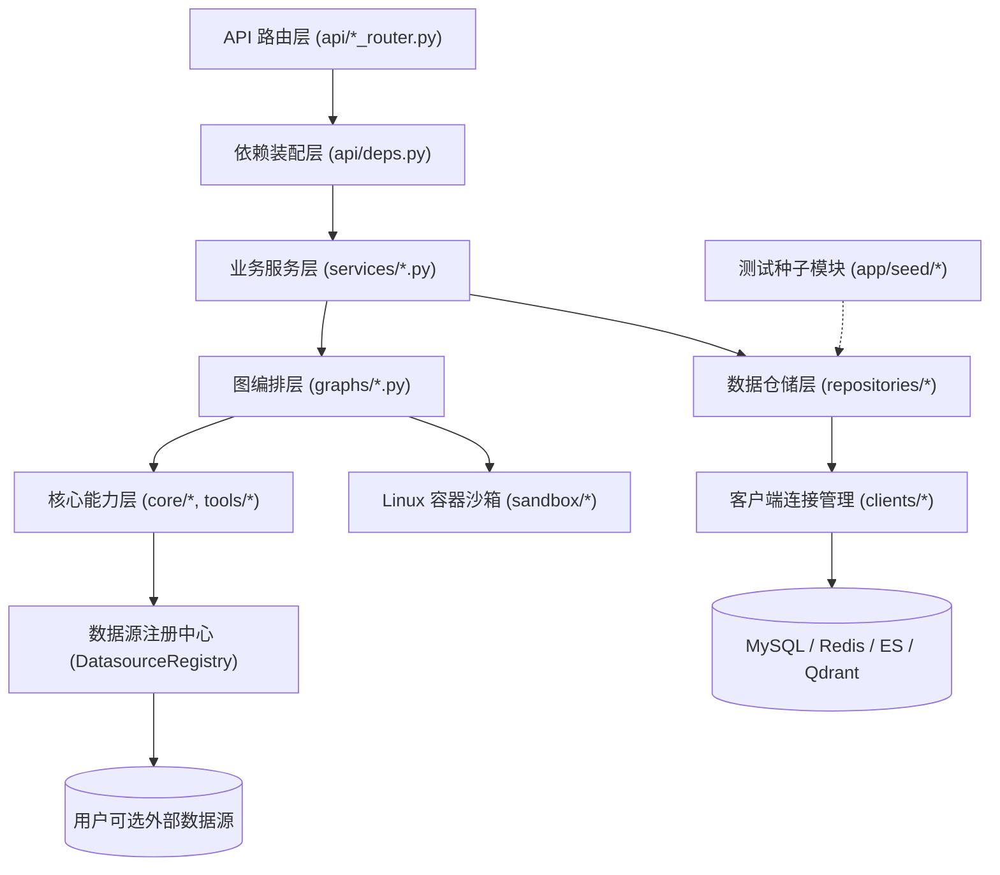

# Auto-Dev Agent 架构文档

## 1. 架构风格

本项目采用类比 `my_swe` 的**分层依赖注入架构**，按职责自上而下划分为路由与依赖装配层、业务服务层、图编排层、核心引擎与沙箱层、数据访问层和基础设施客户端层。

核心原则：

- **依赖倒置与集中装配**：所有数据库引擎、外部客户端和仓储对象由 `clients` 管理生命周期，由 `deps` 统一组装后注入 `services`，服务层不直接实例化底层连接。
- **运行期与持久化状态分离**：LangGraph `State` 只保存可序列化的任务状态；不可序列化的仓储、客户端与注册中心通过 `Runtime[AutoDevContext]` 传入图节点。
- **测试数据物理隔离**：`app/seed/` 独立存在，严禁在 `services` 中编写任何测试逻辑或硬编码配置。

## 2. 目录结构

```text
auto_dev_agent/
├── app/
│   ├── main.py                      # FastAPI 入口
│   ├── config.py                    # 全局环境变量与基础配置
│   ├── api/
│   │   ├── deps.py                  # 依赖装配 (Session/Client/Repo/Service)
│   │   ├── lifespan.py              # 启停生命周期管理
│   │   ├── task_router.py           # 任务流式执行与人工审批接口
│   │   ├── project_router.py        # 项目工作区管理接口
│   │   ├── datasource_router.py     # 用户数据源接入与校验接口
│   │   └── error_cache_router.py    # 报错缓存检索与管理接口
│   ├── clients/
│   │   ├── mysql_client_manager.py  # 平台 MySQL 异步连接池管理器
│   │   ├── redis_client_manager.py  # Redis 连接池管理器 (Checkpointer/锁)
│   │   ├── es_client_manager.py     # Elasticsearch 异步客户端管理器
│   │   ├── qdrant_client_manager.py # Qdrant 异步向量库客户端管理器
│   │   ├── embedding_client_manager.py # Embedding 向量模型客户端管理器
│   │   └── llm_client_manager.py    # LLM 客户端管理 (支持延迟加载)
│   ├── repositories/
│   │   ├── mysql/
│   │   │   ├── project_repo.py      # 项目配置仓储
│   │   │   ├── datasource_repo.py   # 用户数据源配置仓储
│   │   │   ├── task_repo.py         # 任务、消息、证据、补丁持久化仓储
│   │   │   └── error_cache_repo.py  # 报错经验缓存 MySQL 事实源仓储
│   │   ├── es/
│   │   │   ├── error_cache_es_repo.py # 报错缓存 ES BM25 索引仓储
│   │   │   └── runtime_log_es_repo.py # 运行时日志 ES 检索仓储
│   │   ├── qdrant/
│   │   │   └── error_cache_qdrant_repo.py # 报错缓存 Qdrant 向量仓储
│   │   └── redis/
│   │       └── task_cache_repo.py   # 运行锁与断点缓存仓储
│   ├── services/
│   │   ├── task_service.py          # 任务编排、SSE 推流、审批唤醒
│   │   ├── project_service.py       # 项目工作区业务管理
│   │   ├── datasource_service.py    # 数据源注册、连通性校验、注销
│   │   └── error_cache_service.py   # 报错缓存三端同步与 RRF 检索服务
│   ├── graphs/
│   │   ├── context.py               # Runtime[AutoDevContext] 定义
│   │   ├── state.py                 # 主图与子图 State 定义
│   │   ├── main_graph.py            # 主图编排
│   │   ├── evidence_subgraph.py     # 证据探查子图 (报错缓存 + db/log/code)
│   │   └── sandbox_subgraph.py      # Linux 容器沙箱子图
│   ├── core/
│   │   ├── datasource_registry.py   # 用户数据源动态注册中心 (只读 SQL/日志)
│   │   ├── intent_router.py         # 入口意图分流 (bugfix/feature/qa) 与探针裁剪
│   │   ├── chat_chunks.py           # 提示词稳定前缀组装 (含 RepoMap 与 CHAT_FILES 正文)
│   │   ├── repo_map.py              # 复用 aider: Tree-sitter + PageRank 大纲与持久化实例池
│   │   ├── db_repo_map.py           # 基于 M-Schema + PageRank 的库表外键拓扑大纲生成器
│   │   ├── edit_applier.py          # 复用 aider: SEARCH/REPLACE 补丁解析与落盘
│   │   ├── git_ops.py               # 简化自 aider: subprocess Git 包装器
│   │   └── evidence_collector.py    # 复用 my_swe: 脱敏截断与 Evidence 签发器
│   ├── tools/
│   │   ├── db_tools.py              # 数据源只读探查工具
│   │   ├── log_tools.py             # 日志检索与追踪工具 (ES/本地日志)
│   │   ├── cache_tools.py           # ES + Qdrant 报错缓存混合检索工具
│   │   └── code_tools.py            # 代码窗口阅读、正则搜索、Git 历史工具
│   ├── sandbox/
│   │   └── container_runner.py      # 复用 my_swe: Linux Docker (docker cp) 管理器
│   ├── models/
│   │   ├── base.py                  # SQLAlchemy Base
│   │   └── orm_models.py            # ORM 表映射
│   └── schemas/
│       ├── api_schemas.py           # REST 请求与响应模型
│       └── domain_schemas.py        # Evidence、Plan、EditResult 等领域模型
└── app/seed/
    └── seed_runner.py               # 独立测试种子入口 (仅测试环境显式运行)
```

## 3. 分层职责与边界

### 3.1 总体分层图



### 3.2 各层详细边界

| 层级 | 职责 | 允许依赖 | 禁止事项 |
|---|---|---|---|
| api | 参数校验、路由分发、SSE 输出封装 | schemas, services(经 deps 注入) | 直接操作 DB 会话、包含业务逻辑 |
| deps | 管理请求级 Session 与 Repo/Service 装配 | clients, repositories, services, config | 编写业务规则、硬编码业务配置 |
| services | 任务生命周期编排、上下文注入组装、事务边界 | repositories, graphs, schemas, core | 包含任何测试代码、Mock 数据、硬编码路径或测试开关 |
| graphs | 定义 StateGraph 节点、条件路由、中断恢复 | core, tools, sandbox, schemas | 直接拼接 SQL、直接初始化连接池 |
| core / tools | RepoMap 生成、补丁应用、Git 命令、安全工具封装 | schemas, sandbox, datasource_registry | 依赖 FastAPI 请求对象或具体服务状态 |
| sandbox | Linux Docker 容器启停、`docker cp` 同步、容器内执行测试 | config, subprocess/docker CLI | 直接修改用户生产分支、读取宿主机环境变量 |
| repositories | 平台 MySQL 与 Redis 的 CRUD 封装 | models, schemas, SQLAlchemy/Redis | 包含复杂业务决策、直接调用 LLM |
| clients | 连接池初始化、健康检查、优雅关闭 | config, 驱动库 | 包含 SQL 查询、业务表结构知识 |
| seed | 仅提供环境初始化与集成测试种子数据写入 | repositories, schemas, config | 被 services 或 graphs 导入 |

## 4. 关键架构决策与理由

### 4.1 动态数据源注册中心

采用 `DatasourceRegistry` 运行时管理用户接入的数据库与日志数据源连接：

- 用户在项目上绑定数据源后，配置落库 MySQL，并在任务启动时由 `DatasourceRegistry` 按需按连接串建立只读异步引擎或日志检索客户端。
- 执行 SQL 探查前在工具内部校验正则/语法白名单，仅放行只读 `SELECT` / `SHOW` / `EXPLAIN`，阻断写操作。
- 若任务上下文中无有效 `db` 类数据源，注册中心返回空能力描述，探查子图直接不创建 `db_query` 分支。

**决策理由**：比 `my_swe` 更彻底地将“平台管理库”和“用户目标数据源”解耦，满足无数据源时只靠日志与源码运行的要求。

### 4.2 容器沙箱与宿主机解耦

沙箱层沿用 `my_swe` 的 `docker cp` 模式运行于 Linux 容器：

- 不使用 `-v` 宿主机路径挂载，避免 Windows/Linux 跨系统路径映射问题与容器内误改宿主机文件。
- 宿主机仅在临时隔离工作目录生成文件修改，通过 `docker cp` 同步到容器 `/workspace`，再用 `docker exec` 运行测试。

**决策理由**：保障执行环境为纯净 Linux 容器，阻断未审核代码对宿主机文件系统和环境变量的访问。

### 4.3 `aider` 模块复用与裁剪

- **直接复用并服务化改造 `RepoMap`**：抽离为无 CLI 依赖的 `core/repo_map.py`，通过 `RepoMapManager` 维护长生命周期实例保留 L1 `map_cache` 与 L2 SQLite `TAGS_CACHE`，并把 `chat_fnames`、`other_fnames`、`max_map_tokens`、`mentioned_fnames`、`mentioned_idents` 对齐进主图 State。
- **裁剪简化 `GitRepo`**：放弃 `GitPython` 常驻句柄与复杂作者署名逻辑，改用轻量 `subprocess` 封装 `git` CLI（`git status`、`git ls-files`、`git diff`、`git checkout -b`、`git commit`、`git reset`）。
- **吸收 `ChatChunks` 顺序策略**：组装提示词时固定按系统指令、`[REPO_MAP]`、`[CHAT_FILES]`、`[EVIDENCE_POOL]`、历史消息的顺序排列，减少前置上下文变更，提高 Prompt Cache 命中率。

**决策理由**：保留 `aider` 在代码大纲与补丁精准度上的优势，同时去除 CLI 重度状态与外部库句柄隐患，适配异步 FastAPI + LangGraph 服务化架构。

### 4.4 `service` 层纯净性约束落地

通过目录与依赖检查保障：

- 业务初始化参数全部来自数据库记录或接口入参，任何服务方法不设默认测试工程路径。
- 数据初始化接口不暴露在业务 `task_service.py` 中，测试用数据准备统一通过命令行运行 `python -m app.seed.seed_runner` 完成。

**决策理由**：从架构依赖层面杜绝演示代码污染核心引擎。

### 4.5 报错缓存与证据收集模块

直接移植并适配 `my_swe` 的 `evidence_collector.py` 与双路混合检索机制：

- **统一证据签发**：所有工具结果经 `redact_text()` 过滤密钥/手机号并截断长度，由 `build_evidence()` 根据工具名、参数与输出前 512 字节生成确定性短哈希 ID（如 `ev_db:`、`ev_log:`、`ev_code:`、`ev_cache:`）。
- **ES + 向量库报错缓存**：ES (`error_cache_es_repo`) 负责异常类名、错误码和堆栈关键词的 BM25 精确召回；Qdrant (`error_cache_qdrant_repo`) 负责口语化故障症状的语义向量召回，两者经 RRF (`k=60`) 融合排序。
- **动态日志检索分离与降级**：平台自身的报错经验缓存与用户可选接入的运行时日志 ES 检索分别由独立仓储管理，互不混淆。日志探针工具 (`log_tools.py`) 采用两级策略：当任务上下文注入了 ES 日志仓储与索引名时，直接查询 ES；未配置 ES 时自动降级扫描本地日志文件（优先读取任务入参 `log_path`，未指定则在 `repo_root` 下按通用通配规则如 `*.log` 做带路径防越界与行数上限的只读扫描，禁止在 `services` 中硬编码日志路径）。

**决策理由**：单纯向量检索容易漏掉精确异常类名或错误码，单纯关键词检索无法处理口语化描述；同时 `evidence_collector` 将脱敏和证据编号签发收口到工具层，避免模型伪造证据编号。
