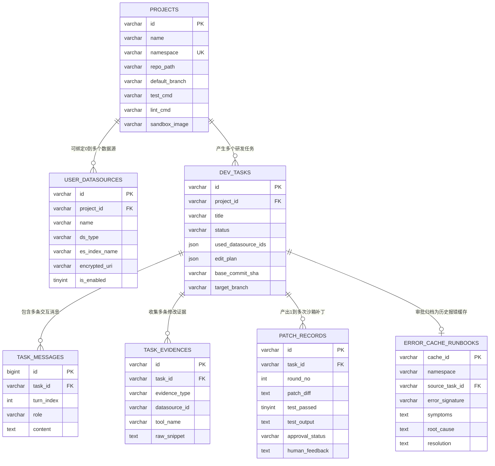

# Auto-Dev Agent 数据库文档

## 1. 存储引擎规划

平台使用 MySQL、Redis、Elasticsearch、Qdrant 四个引擎支撑任务编排与报错缓存检索；用户业务数据源按需动态接入。

| 存储引擎 | 职责 | 理由 |
|---|---|---|
| MySQL 8.0 | 持久化项目、数据源、任务、消息、证据账本、补丁审批、报错缓存主表 | 强一致事务与结构化关联查询，作报错缓存唯一事实源 |
| Redis | LangGraph Checkpointer 状态快照、任务并发互斥锁 | 支撑 `interrupt()` 挂起恢复与并发防重入 |
| Elasticsearch | 存储历史报错缓存 BM25 索引，以及可选的运行时日志索引 | 精准匹配异常类名、错误码、堆栈与 TraceID |
| Qdrant | 存储历史报错缓存稠密向量集合 | 在无精确报错码时按症状语义召回相似历史修复方案 |
| 用户外部数据源 | 仅在用户接入并指定时由 `DatasourceRegistry` 只读访问 | 不强绑定平台基础设施，无配置则不连接 |

## 2. 实体关系图



## 3. 表结构设计

### 3.1 `projects` (目标项目配置表)

```sql
CREATE TABLE `projects` (
    `id` VARCHAR(64) NOT NULL COMMENT '项目主键',
    `name` VARCHAR(128) NOT NULL COMMENT '项目名称',
    `namespace` VARCHAR(128) NOT NULL COMMENT '隔离命名空间：用户配置传入，未传则规范化项目目录名+短哈希',
    `repo_path` VARCHAR(512) NOT NULL COMMENT '本地 Git 仓库绝对路径',
    `default_branch` VARCHAR(64) NOT NULL DEFAULT 'main' COMMENT '基线分支',
    `test_cmd` VARCHAR(255) NOT NULL DEFAULT 'pytest -q' COMMENT '沙箱单测命令',
    `lint_cmd` VARCHAR(255) NULL COMMENT '沙箱静态检查命令',
    `sandbox_image` VARCHAR(128) NOT NULL DEFAULT 'python:3.12-slim' COMMENT 'Linux 容器镜像',
    `created_at` DATETIME NOT NULL DEFAULT CURRENT_TIMESTAMP,
    `updated_at` DATETIME NOT NULL DEFAULT CURRENT_TIMESTAMP ON UPDATE CURRENT_TIMESTAMP,
    PRIMARY KEY (`id`),
    UNIQUE KEY `uk_project_name` (`name`),
    UNIQUE KEY `uk_project_namespace` (`namespace`)
) ENGINE=InnoDB DEFAULT CHARSET=utf8mb4 COMMENT='目标开发项目配置表';
```

### 3.2 `user_datasources` (用户数据源接入表)

```sql
CREATE TABLE `user_datasources` (
    `id` VARCHAR(64) NOT NULL COMMENT '数据源主键',
    `project_id` VARCHAR(64) NOT NULL COMMENT '关联 projects.id',
    `name` VARCHAR(128) NOT NULL COMMENT '数据源展示名',
    `ds_type` VARCHAR(32) NOT NULL COMMENT '类型: mysql / postgres / elasticsearch / log_file',
    `es_index_name` VARCHAR(128) NULL COMMENT '可选自定义 ES 日志索引名，仅 ds_type=elasticsearch 时生效',
    `encrypted_uri` VARCHAR(1024) NOT NULL COMMENT '加密存储的连接串或日志路径配置',
    `metadata_json` JSON NULL COMMENT '附加配置如 Schema 白名单、过滤字段',
    `is_enabled` TINYINT(1) NOT NULL DEFAULT 1 COMMENT '是否启用',
    `created_at` DATETIME NOT NULL DEFAULT CURRENT_TIMESTAMP,
    `updated_at` DATETIME NOT NULL DEFAULT CURRENT_TIMESTAMP ON UPDATE CURRENT_TIMESTAMP,
    PRIMARY KEY (`id`),
    KEY `idx_ds_project_type` (`project_id`, `ds_type`, `is_enabled`),
    CONSTRAINT `fk_ds_project` FOREIGN KEY (`project_id`) REFERENCES `projects` (`id`) ON DELETE CASCADE
) ENGINE=InnoDB DEFAULT CHARSET=utf8mb4 COMMENT='用户动态接入的数据源配置表';
```

### 3.3 `dev_tasks` (研发任务主表)

```sql
CREATE TABLE `dev_tasks` (
    `id` VARCHAR(64) NOT NULL COMMENT '任务主键，兼任 LangGraph thread_id',
    `project_id` VARCHAR(64) NOT NULL COMMENT '关联 projects.id',
    `title` VARCHAR(255) NOT NULL COMMENT '任务标题',
    `user_query` TEXT NOT NULL COMMENT '原始需求或报错描述',
    `status` VARCHAR(32) NOT NULL DEFAULT 'running' COMMENT 'running / waiting_approval / completed / failed',
    `used_datasource_ids` JSON NULL COMMENT '本次任务显式绑定的数据源 ID 列表，可为 null',
    `edit_plan` JSON NULL COMMENT '文件级修改计划清单',
    `base_commit_sha` VARCHAR(64) NULL COMMENT '任务开始前 Git HEAD SHA',
    `target_branch` VARCHAR(128) NULL COMMENT '生成并提交的目标分支名',
    `final_commit_sha` VARCHAR(64) NULL COMMENT '审批后最终提交 SHA',
    `created_at` DATETIME NOT NULL DEFAULT CURRENT_TIMESTAMP,
    `updated_at` DATETIME NOT NULL DEFAULT CURRENT_TIMESTAMP ON UPDATE CURRENT_TIMESTAMP,
    PRIMARY KEY (`id`),
    KEY `idx_task_project_status` (`project_id`, `status`),
    CONSTRAINT `fk_task_project` FOREIGN KEY (`project_id`) REFERENCES `projects` (`id`) ON DELETE CASCADE
) ENGINE=InnoDB DEFAULT CHARSET=utf8mb4 COMMENT='自主研发任务主表';
```

### 3.4 `task_messages` (任务交互消息表)

```sql
CREATE TABLE `task_messages` (
    `id` BIGINT NOT NULL AUTO_INCREMENT COMMENT '自增主键',
    `task_id` VARCHAR(64) NOT NULL COMMENT '关联 dev_tasks.id',
    `turn_index` INT NOT NULL DEFAULT 1 COMMENT '对话轮次',
    `role` VARCHAR(32) NOT NULL COMMENT 'user / assistant / system',
    `content` MEDIUMTEXT NOT NULL COMMENT '消息正文',
    `created_at` DATETIME NOT NULL DEFAULT CURRENT_TIMESTAMP,
    PRIMARY KEY (`id`),
    KEY `idx_msg_task_turn` (`task_id`, `turn_index`),
    CONSTRAINT `fk_msg_task` FOREIGN KEY (`task_id`) REFERENCES `dev_tasks` (`id`) ON DELETE CASCADE
) ENGINE=InnoDB DEFAULT CHARSET=utf8mb4 COMMENT='任务对话历史表';
```

### 3.5 `task_evidences` (修改依据证据表)

```sql
CREATE TABLE `task_evidences` (
    `id` VARCHAR(64) NOT NULL COMMENT '证据编号，如 ev_db:a1b2c3 / ev_log:d4e5f6 / ev_code:7890ab / ev_cache:112233',
    `task_id` VARCHAR(64) NOT NULL COMMENT '关联 dev_tasks.id',
    `evidence_type` VARCHAR(32) NOT NULL COMMENT 'db_query / log_error / source_code / error_cache',
    `datasource_id` VARCHAR(64) NULL COMMENT '来源外部数据源 ID，源码证据为 NULL',
    `tool_name` VARCHAR(64) NOT NULL COMMENT '触发采集的工具名',
    `query_args` VARCHAR(1024) NOT NULL COMMENT '脱敏后的查询参数 JSON',
    `summary` VARCHAR(512) NOT NULL COMMENT '证据摘要',
    `raw_snippet` TEXT NOT NULL COMMENT '脱敏截断后的原始片段',
    `created_at` DATETIME NOT NULL DEFAULT CURRENT_TIMESTAMP,
    PRIMARY KEY (`id`, `task_id`),
    KEY `idx_ev_task_type` (`task_id`, `evidence_type`),
    CONSTRAINT `fk_ev_task` FOREIGN KEY (`task_id`) REFERENCES `dev_tasks` (`id`) ON DELETE CASCADE
) ENGINE=InnoDB DEFAULT CHARSET=utf8mb4 COMMENT='代码修改证据账本表';
```

### 3.6 `patch_records` (沙箱补丁与审批记录表)

```sql
CREATE TABLE `patch_records` (
    `id` VARCHAR(64) NOT NULL COMMENT '补丁记录主键',
    `task_id` VARCHAR(64) NOT NULL COMMENT '关联 dev_tasks.id',
    `round_no` INT NOT NULL DEFAULT 1 COMMENT '第几轮沙箱提交',
    `edited_files` JSON NOT NULL COMMENT '改动文件相对路径列表',
    `patch_diff` MEDIUMTEXT NOT NULL COMMENT 'Unified Git Diff',
    `test_passed` TINYINT(1) NOT NULL DEFAULT 0 COMMENT '沙箱单测是否通过',
    `retry_count` INT NOT NULL DEFAULT 0 COMMENT '沙箱自愈重试次数',
    `test_output` TEXT NULL COMMENT '容器内执行测试的输出日志',
    `approval_status` VARCHAR(32) NOT NULL DEFAULT 'pending' COMMENT 'pending / approved / rejected',
    `human_feedback` TEXT NULL COMMENT '人工驳回反馈',
    `created_at` DATETIME NOT NULL DEFAULT CURRENT_TIMESTAMP,
    `updated_at` DATETIME NOT NULL DEFAULT CURRENT_TIMESTAMP ON UPDATE CURRENT_TIMESTAMP,
    PRIMARY KEY (`id`),
    KEY `idx_patch_task_round` (`task_id`, `round_no`),
    CONSTRAINT `fk_patch_task` FOREIGN KEY (`task_id`) REFERENCES `dev_tasks` (`id`) ON DELETE CASCADE
) ENGINE=InnoDB DEFAULT CHARSET=utf8mb4 COMMENT='沙箱补丁验证与人工审批记录表';
```

### 3.7 `error_cache_runbooks` (历史报错缓存主表)

```sql
CREATE TABLE `error_cache_runbooks` (
    `cache_id` VARCHAR(64) NOT NULL COMMENT '缓存经验主键，全局唯一 (如 err_8f3a1c2d)',
    `namespace` VARCHAR(128) NOT NULL COMMENT '所属项目隔离命名空间，对应 projects.namespace',
    `source_task_id` VARCHAR(64) NULL COMMENT '来源任务 ID',
    `project_id` VARCHAR(64) NOT NULL COMMENT '来源项目 ID',
    `error_signature` VARCHAR(255) NOT NULL COMMENT '异常类名或错误签名',
    `error_keywords` VARCHAR(512) NOT NULL COMMENT '报错关键词，用于 ES BM25 加权匹配',
    `symptoms` TEXT NOT NULL COMMENT '故障现象与复现上下文',
    `root_cause` TEXT NOT NULL COMMENT '定位根因说明',
    `resolution` TEXT NOT NULL COMMENT '代码修改与修复方案',
    `created_at` DATETIME NOT NULL DEFAULT CURRENT_TIMESTAMP,
    PRIMARY KEY (`cache_id`),
    KEY `idx_cache_ns_sig` (`namespace`, `error_signature`),
    CONSTRAINT `fk_cache_task` FOREIGN KEY (`source_task_id`) REFERENCES `dev_tasks` (`id`) ON DELETE SET NULL,
    CONSTRAINT `fk_cache_project` FOREIGN KEY (`project_id`) REFERENCES `projects` (`id`) ON DELETE CASCADE
) ENGINE=InnoDB DEFAULT CHARSET=utf8mb4 COMMENT='报错经验缓存唯一事实源表';
```

### 3.8 命名空间与 ID 组成规范

| 标识对象 | 生成与组成方式 | 用途说明 |
|---|---|---|
| 项目 `namespace` | 优先取用户注册时显式传入的配置值；未传时取规范化项目目录名与路径短哈希组合，格式 `{dir_slug}_{sha1(abs_repo_path)[:4]}`（如 `order_api_8a2f`） | 隔离 ES 与 Qdrant 报错缓存检索边界，防止不同项目或同名目录相互污染 |
| 报错缓存 `cache_id` | 基于归一化后的 `namespace + error_signature + root_cause` 计算截断哈希，格式 `err_{sha1[:10]}` | 作为 MySQL 主键及跨三端关联键，同一项目相同根因幂等更新 |
| ES 报错缓存 `_id` | 直接拼接命名空间与缓存 ID，格式 `es_{namespace}_{cache_id}` | 保证同一 ES 索引内跨命名空间文档 ID 永不覆盖冲突 |
| Qdrant Point `id` | Qdrant 仅支持 UUID 或无符号整数，使用确定性 UUIDv5 生成：`str(uuid.uuid5(uuid.NAMESPACE_DNS, f"{namespace}:{cache_id}"))` | 保证相同命名空间同一经验幂等 upsert，同时支持跨项目隔离 |
| 用户 ES 日志 `_id` | 若写入或索引同步时生成，建议 `{trace_id}_{seq}`；用户自有索引按只读查询，不强制重写原有 `_id` | 仅在平台辅助建索引或测试种子写入时保证单链路日志唯一 |

### 3.9 Elasticsearch 结构设计

#### 报错缓存 BM25 索引 (`auto_dev_error_cache_bm25`)

单索引存储并通过 `namespace` 字段强隔离（检索时必须在 `bool.filter` 中携带 `{"term": {"namespace": namespace}}`）：

```json
{
  "mappings": {
    "dynamic": false,
    "properties": {
      "cache_id":        { "type": "keyword" },
      "namespace":       { "type": "keyword" },
      "project_id":      { "type": "keyword" },
      "error_signature": { "type": "text" },
      "error_keywords":  { "type": "text" },
      "symptoms":        { "type": "text" },
      "root_cause":      { "type": "text" },
      "resolution":      { "type": "text" },
      "created_at":      { "type": "date" }
    }
  }
}
```

- **BM25 查询权重**：`multi_match` 检索字段按 `["error_keywords^3", "error_signature^2", "symptoms"]` 加权，外层强制包裹 `bool.filter: [{"term": {"namespace": namespace}}]`。

#### 用户可选 ES 运行时日志索引 (自定义索引名 + 特定结构)

用户可在接入数据源时通过 `es_index_name` 选择性配置自己的 ES 日志索引名（未配置则跳过 ES 日志探查），但所指定索引的文档必须包含以下特定字段结构：

```json
{
  "mappings": {
    "dynamic": false,
    "properties": {
      "timestamp":  { "type": "keyword" },
      "trace_id":   { "type": "keyword" },
      "level":      { "type": "keyword" },
      "service":    { "type": "keyword" },
      "api_path":   { "type": "keyword" },
      "user_id":    { "type": "keyword" },
      "file_line":  { "type": "keyword" },
      "message":    { "type": "text" },
      "stacktrace": { "type": "text" }
    }
  }
}
```

| 字段名 | ES 类型 | 必填 | 用途 |
|---|---|---|---|
| `timestamp` | `keyword` / `date` | 是 | 日志产生时间，用于时间窗口排序 |
| `trace_id` | `keyword` | 是 | 链路追踪 ID，供 `get_trace_logs` 拉取全链路 |
| `level` | `keyword` | 是 | 日志级别 (`ERROR` / `WARN` / `INFO`) |
| `service` | `keyword` | 否 | 所属服务名 |
| `api_path` | `keyword` | 否 | 请求接口路由 |
| `user_id` | `keyword` | 否 | 关联业务用户 ID |
| `file_line` | `keyword` | 否 | 报错文件与行号位置 |
| `message` | `text` | 是 | 日志正文 |
| `stacktrace` | `text` | 是 | 异常完整堆栈文本，供 `log_probe_worker` 定位代码 |

- **接入校验机制**：注册自定义 ES 日志索引时，服务层检查目标索引是否存在并校验核心字段（`timestamp`、`trace_id`、`level`、`message`、`stacktrace`）映射是否符合规范；缺少关键字段时拒绝接入。

### 3.10 Qdrant 向量库结构设计

#### 集合配置 (`auto_dev_error_cache_vec`)

- **向量维度与距离度量**：维度与所用 Embedding 模型对齐（如 `1024`），距离算法 `Distance.COSINE`。
- **向量化输入文本**：将 `f"{error_signature}\n{symptoms}\n{root_cause}"` 拼接后编码写入。
- **Payload 字段结构与过滤索引**：

| Payload 字段 | 类型 | 建立 Payload 索引 | 说明 |
|---|---|---|---|
| `cache_id` | `keyword` | 否 | 对应 MySQL 与 ES 的唯一经验 ID |
| `namespace` | `keyword` | 是 (`KEYWORD`) | 命名空间强隔离键，`query_points` 必传过滤条件 |
| `project_id` | `keyword` | 是 (`KEYWORD`) | 关联项目 ID |
| `error_signature` | `string` | 否 | 异常签名摘要 |
| `error_keywords` | `string` | 否 | 异常关键词 |
| `symptoms` | `string` | 否 | 故障现象 |
| `root_cause` | `string` | 否 | 根因说明 |
| `resolution` | `string` | 否 | 修复方案 |

- **强隔离检索约束**：每次调用 Qdrant `query_points()` 必须携带 `query_filter=Filter(must=[FieldCondition(key="namespace", match=MatchValue(value=namespace))])`，禁止无过滤跨命名空间全局向量召回。

## 4. 数据库设计决策与理由

1. **业务库不包含测试靶场表**：平台库 `auto_dev_db` 只存平台自身元数据；测试用外部业务表只允许在独立测试环境由 `app/seed/` 初始化后作为一条 `user_datasources` 记录接入。
2. **复合主键 `(id, task_id)` 防止证据冲突**：基于 `evidence_collector` 哈希生成的 `ev_code:xxxxxx` 在不同任务间可能指向同一段代码，复合主键既能保证单任务内去重，又避免跨任务插入主键冲突。
3. **`evidence_type` 强约束枚举**：严格校验 `db_query`、`log_error`、`source_code`、`error_cache`，保障每次代码修改都能按来源检索审计。
4. **`encrypted_uri` 加密落库**：用户接入外部数据源的连接串可能含密码，落库前加密存储并在服务层内存中按需解密注入注册中心。
5. **逻辑命名空间隔离优于物理分库分索引**：ES 与 Qdrant 采用单索引/单集合配合 `namespace` 强制过滤与复合 ID（`es_{namespace}_{cache_id}` 与 UUIDv5），既避免大量项目接入时分片和集合内存膨胀，又确保检索零串库；未传入命名空间时自动以规范化项目目录名加路径短哈希兜底，避免同名目录冲突。
6. **自定义 ES 日志索引强制结构对齐**：允许用户自由传入自己项目的 `es_index_name` 实现多项目日志物理隔离，但强制约束特定字段 mapping，确保 `log_tools` 查询逻辑通用且无需针对特定业务硬编码。
