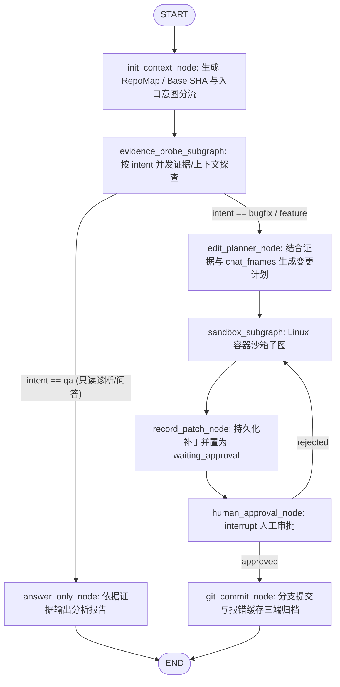
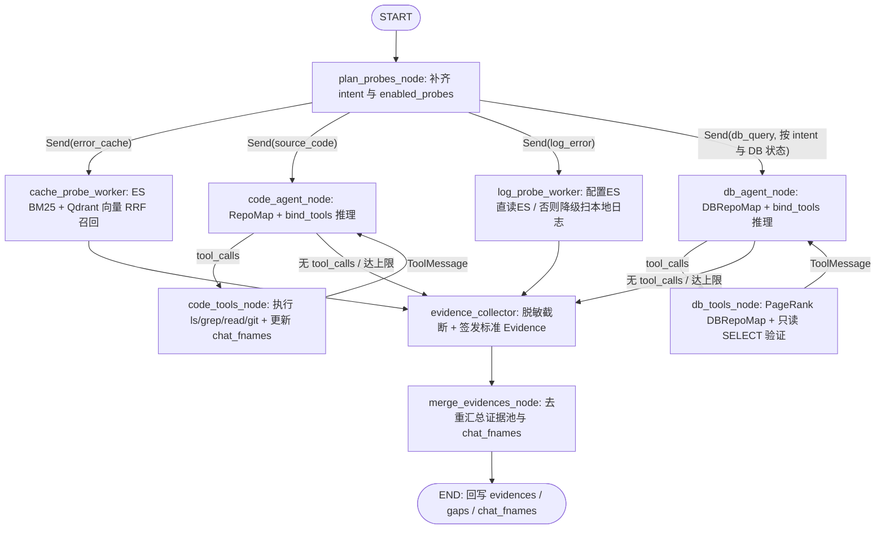
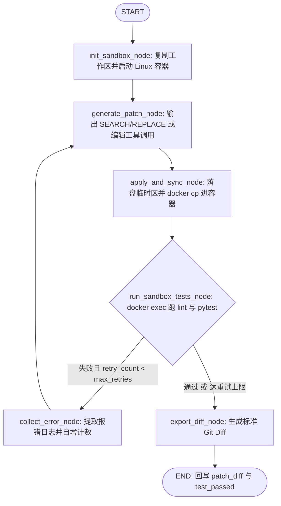

# Auto-Dev Agent LangGraph 设计图

## 1. 全局拓扑架构

系统由 **1 个主图** 和 **2 个核心子图** 组成：

- **主图 (`main_dev_graph`)**：负责 RepoMap 大纲与入口意图分流（`bugfix` / `feature` / `qa`）、证据调度、只读诊断直接收束、变更规划、人工审批、Git 提交与报错缓存归档。
- **子图 1 (`evidence_probe_subgraph`)**：按分流结果 `enabled_probes` 动态派发探针；其中 `code_probe_worker` 由模型结合 `RepoMap` 自主调度只读源码工具并维护 `chat_fnames`，并集成 `ES + Qdrant` 报错缓存、`log_error` 与 `db_query` 并发收集证据。
- **子图 2 (`sandbox_subgraph`)**：注入 `[REPO_MAP]` 与 `[CHAT_FILES]` 正文在 Linux Docker 容器中应用修改或创建文件（空 `SEARCH` 块）、执行测试并完成错误自愈闭环。



## 2. 子图 1：证据探查子图 (`evidence_probe_subgraph`)

### 2.1 运行机制

- **意图驱动与数据源条件调度**：`init_context_node`（及独立调用子图时的 `plan_probes_node`）生成 `intent` 与 `enabled_probes`，`route_probes_edge` 按需派发：
  - **源码自主探查 (`source_code`)**：始终启用。`code_probe_worker` 本质是一个独立编译的 LangGraph ReAct 子图（`code_probe_subgraph`），拆分为 `code_agent_node`（模型基于 `RepoMap`、需求与观察历史推理下一步动作）与 `code_tools_node`（执行 4 个只读工具 `list_repo_directory` / `search_repo_code` / `read_repo_file` / `git_recent_commits` 并返回 `ToolMessage`、`evidences` 与 `chat_fnames`），经 `route_code_probe_tools` 条件边循环直至模型停止调工具或达到最大轮次（无有效 LLM Key 时降级确定性规则）。
  - **报错缓存双路检索 (`error_cache`)**：`bugfix` 默认启用、`qa` 涉报错启用、`feature` 创建跳过；并行查询 `ES (BM25)` 与 `Qdrant (向量)` 并经 `RRF (k=60)` 融合。
  - **运行日志探针 (`log_error`)**：`bugfix` 默认启用、`qa` 在传入日志线索时启用、`feature` 创建跳过；有 ES 索引直读 ES，无则降级扫描 `log_path` 或工作区 `*.log`。
  - **数据库自主探查 (`db_query`)**：仅当 `has_db_datasource == True` 且当前意图需要时派发。`db_probe_worker` 同样是独立编译的 2 节点 ReAct 子图（`db_probe_subgraph`）：由 `db_agent_node` 与 `db_tools_node` 组成，绑定 `get_db_repo_map`（基于 `DBRepoMap` 对全库表结构、主键、物理外键/`<target>_id` 推断关联边和索引执行 Personalized PageRank 排序并按 `max_tokens` 二分裁剪）、`inspect_table_detail` 与 `run_readonly_sql`（只读 `SELECT / SHOW / EXPLAIN` 核验字段偏差、异常数据或报错 SQL）。无有效 LLM Key 时降级执行一次确定性 `DBRepoMap` 取证。
- **统一证据收集器**：所有探针工具输出均通过 `my_swe` 的 `evidence_collector`（`redact_text` + `build_evidence`）自动脱敏截断并签发防伪哈希 ID（`ev_cache:` / `ev_code:` / `ev_log:` / `ev_db:`），汇总去重写回主图。

### 2.2 子图结构



## 3. 子图 2：Linux 容器沙箱子图 (`sandbox_subgraph`)

### 3.1 运行机制

- 容器启停与文件写入完全通过 `LinuxContainerSandbox` 的临时工作目录和 `docker cp` 完成，测试命令通过 `docker exec` 在 Linux 容器内执行。
- 子图内部维护局部 `retry_count` 和局部修改上下文；测试失败时将控制台报错输出带回 `generate_patch_node` 进行增量修复，不污染主图对话消息。

### 3.2 子图结构



## 4. State 与 Context 设计

### 4.1 主图状态 (`AutoDevMainState`)

```python
class AutoDevMainState(TypedDict):
    task_id: str
    project_id: str
    user_query: str
    messages: Annotated[list[AnyMessage], add_messages]

    # 上下文与探查开关 (对齐 aider RepoMap / get_ranked_tags_map 参数契约 + 独立 DBRepoMap)
    repo_map: str
    db_repo_map: Annotated[str, _merge_non_empty_str]
    chat_fnames: Annotated[list[str], _merge_str_list]
    other_fnames: list[str]
    max_map_tokens: int | None
    mentioned_fnames: list[str]
    mentioned_idents: list[str]
    base_commit_sha: str
    has_db_datasource: bool
    has_log_datasource: bool
    intent: TaskIntent
    enabled_probes: list[EvidenceType]

    # 证据探查输出
    evidences: Annotated[list[Evidence], _dedup_evidences]
    gaps: Annotated[list[str], operator.add]
    diagnosis_report: str | None

    # 修改规划与沙箱输出
    edit_plan: list[dict]
    edited_files: list[str]
    patch_diff: str
    test_passed: bool
    test_output: str
    local_sandbox_dir: str

    # 人工审批与交付
    approval_status: Literal["pending", "approved", "rejected"]
    human_feedback: str | None
    commit_message: str | None
    target_branch: str | None
    final_commit_sha: str | None
    cache_archived: bool
```

### 4.2 证据子图状态 (`ProbeWorkerState`)

```python
class ProbeWorkerState(TypedDict):
    probe_type: Literal["error_cache", "db_query", "log_error", "source_code"]
    intent: TaskIntent
    target_question: str
    repo_map: str
    db_repo_map: Annotated[str, _merge_non_empty_str]
    worker_messages: Annotated[list[AnyMessage], add_messages]
    chat_fnames: Annotated[list[str], _merge_str_list]
    evidences: Annotated[list[Evidence], _dedup_evidences]
    gaps: Annotated[list[str], operator.add]
```

### 4.3 沙箱子图状态 (`SandboxSubState`)

```python
class SandboxSubState(TypedDict):
    edit_plan: list[dict]
    evidences: list[Evidence]
    repo_map: str
    db_repo_map: str
    chat_fnames: list[str]
    intent: TaskIntent
    user_query: str
    human_feedback: str | None
    local_sandbox_dir: str
    pending_patch_text: str
    edited_files: list[str]
    patch_diff: str
    test_passed: bool
    test_output: str
    retry_count: int
    max_retries: int
```

### 4.4 运行期上下文 (`AutoDevContext`)

仅承载不可序列化对象和动态连接配置，由 `services` 在调用图时通过 `context=...` 注入，不进 Checkpointer：

```python
class AutoDevContext(TypedDict):
    task_id: str
    project_id: str
    namespace: str
    repo_root: str
    datasource_registry: DatasourceRegistry
    active_datasource_ids: list[str]
    es_log_index: str | None
    log_path: str | None
    task_repo: TaskRepository
    error_cache_repo: ErrorCacheRepository
    error_cache_es_repo: ErrorCacheESRepository
    error_cache_qdrant_repo: ErrorCacheQdrantRepository
    runtime_log_es_repo: RuntimeLogESRepository | None
    embedding_client: OpenAIEmbeddings
    sandbox_image: str
    test_cmd: str
    lint_cmd: str | None
```

## 5. 设计决策与理由

1. **入口意图分流与探针并发隔离**：`init_context_node` 先判定 `intent`（`bugfix` / `feature` / `qa`）并裁剪 `enabled_probes`，再交由 `evidence_probe_subgraph` 并发执行；每个探针拥有隔离的 `worker_messages`，`code_probe_worker` 与 `db_probe_worker` 均采用 2 节点 ReAct 子图，分别基于 `RepoMap` 与 `DBRepoMap` 自主调度只读工具取证。
2. **只读诊断与改码链路分离**：纯问答/排查类任务 (`qa`) 在 `evidence_probe_subgraph` 后经 `route_after_evidence` 进入 `answer_only_node` 直接结束，不再误入 `edit_planner_node`、沙箱与人工审批；`bugfix` 与 `feature` 则共用沙箱与 `SEARCH/REPLACE` 交付链（创建新文件使用空 `SEARCH` 块）。
3. **主图与沙箱之间仅传递 `patch_diff`、`edited_files`、`test_passed`**：沙箱子图读取 `[REPO_MAP]` 与 `[CHAT_FILES]` 正文执行自愈循环，中间失败堆栈留在子图内消化，保证主图 State 轻量。
4. **审批驳回直接回到 `sandbox_subgraph`**：基于 `human_feedback` 重新生成并再次经过完整 Linux 容器回归测试；审批通过后在 `git_commit_node` 同步沉淀报错缓存到 MySQL + ES + Qdrant，形成闭环。
